# Vault Heist: The Living Vault

**Written Project Report**  
Data Structures — Semester 3  

| | |
| --- | --- |
| **Arslan** | 25I-3101 |
| **Anas** | 25I-3062 |
| **Stack** | C++17, CMake, SFML 3.0 |
| **Date** | November 2026 |

---

## Abstract

Vault Heist is a single-player GUI puzzle game in which the vault map is a tree (and, in the finale, a Max Heap). Every comparison or visit raises an alarm meter, so tree height and balance are felt as pressure rather than only calculated on paper. We implemented BinaryTree, BST, AVLTree and MaxHeap from scratch with custom `DynArray`, `Stack` and `Queue` containers (no STL containers or algorithms in the core model). The model emits an `EventLog`; the GUI replays it through an `AnimationController`, keeping data structures unit-testable and independent of SFML. The campaign covers four acts (binary tree, BST, AVL, heap/Heap Sort), plus Endless mode, Sandbox, save/load and a local leaderboard. This report summarises architecture, algorithmic complexity, testing, the four AVL rotations with before/after screenshots, Act 4 heap demos, GUI captures, and Section 10 benchmarks regenerated with our `bench` executable.

---

## 1. Introduction and goals

The project brief requires a playable game that teaches tree and heap operations by using them: traversals and reconstruction, BST search/insert/delete/range, AVL rebalancing and order statistics, then Max Heap construction, extract-max and Heap Sort under the same alarm rules.

**Goals we implemented**

1. From-scratch BinaryTree, BST, AVL (with subtree sizes for `kth` / `rank`) and MaxHeap / Heap Sort.  
2. Event-driven visualisation: model mutates once; GUI replays the log.  
3. Campaign (20 levels), Endless survival, Sandbox, scoring, stars, progress save and leaderboard.  
4. Deterministic benchmarks comparing BST vs AVL height/search/rotations/order statistics, and Heap Sort vs quadratic baselines.

---

## 2. System architecture

Dependencies point downward only.

| Layer | Location | Responsibility |
| --- | --- | --- |
| **Model** | `src/model`, `src/util` | Nodes, EventLog, BinaryTree / BST / AVLTree, MaxHeap, validators, DynArray / Stack / Queue / Rng |
| **Gamecore** | `src/game` | Level JSON, ScoreSystem, LevelPlay + Acts 1–4 logic, TreeLayout / TreeMotion |
| **GUI** | `src/gui` | Screens, AnimationController, Renderer, TreeAnimationView, HeapView, LevelChrome |
| **Apps** | `src/main.cpp`, `tests`, `bench` | Thin entry points |

**Acts 1–3** use Anas’s `LevelPlay` implementations; Arslan’s `TreeMissionScreen` presents them in the shared vault chrome (clicks, highlights, undo/hint/replay). **Act 4** uses `HeapLevelScreen`: extract is root↔last-active then seal into the sorted region; restoring the heap is done with **manual** parent–child swaps (no auto-heapify extract in gameplay).

**Event / undo model.** Operations return an `EventLog` of plain records (type, node ids, values, extras). `AnimationController` stores the log and rebuilds visuals by replaying a prefix with eased progress. Undo uses level snapshots (and shorter replay), not inverse tree operations. Tests can set `recordEvents = false` and still assert shapes and results.

---

## 3. Conventions and complexity

- Height: empty tree `0`, leaf `1`.  
- AVL balance factor: `height(left) − height(right)`; balanced iff `|bf| ≤ 1`.  
- For BST/AVL nodes, `key == value` (including after two-child delete swaps).

### 3.1 Selected complexities

| Structure | Operation | Time |
| --- | --- | --- |
| BinaryTree | traversals, height, diameter, mirror, serialize | O(n) |
| BST | search / insert / delete | O(h) (worst O(n) if skewed) |
| BST | rangeQuery | O(h + m) with pruning |
| BST | kthSmallest | O(h + k) inorder |
| AVL | insert / delete / kth / rank | O(log n) |
| AVL | rotateLeft/Right at known node | O(1) pointers (+ O(n) if id search) |
| MaxHeap | buildMaxHeap | O(n) |
| MaxHeap | sift / extract / Heap Sort | O(log n) / O(n log n) |

Notation: `n` nodes, `h` height, `m` keys reported by a range.

---

## 4. Game design (brief alignment)

**Alarm.** Capacity = ⌈1.5 × optimalSteps⌉ + 2. Visiting/comparing (and Act 4 invalid moves) fill the meter; full meter fails the level.

**Stars.** 3 = optimal steps, no penalties; 2 = within 1.25× optimal and ≤1 penalty; 1 = cleared within capacity; 0 = alarm full. Hints cap stars at 2. Score ≈ 1000 − 10×alarm − penalties + bonuses (floored at 0).

**Campaign.** Four acts × five levels. Level *N* unlocks only after level *N−1* has at least one star.

**Endless.** Timed mixed inserts/deletes on an AVL; the tree must stay valid. Survival seconds are posted to the local leaderboard as `Endless`.

---

## 5. Graphical user interface

### 5.1 Main menu

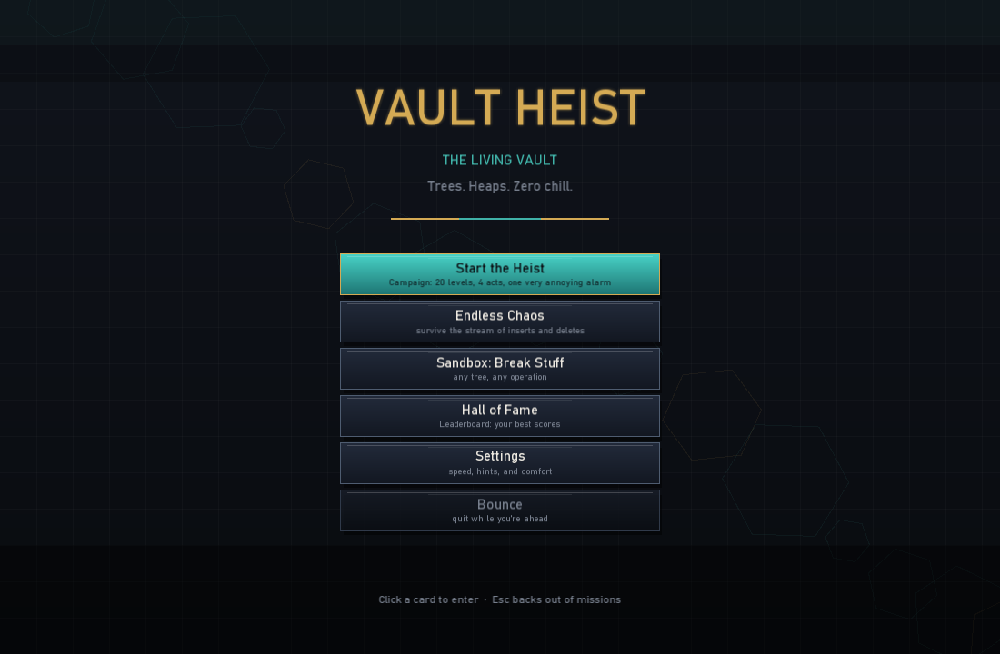

*Figure 1. Main menu — campaign, endless, sandbox, leaderboard, settings.*

### 5.2 Campaign map

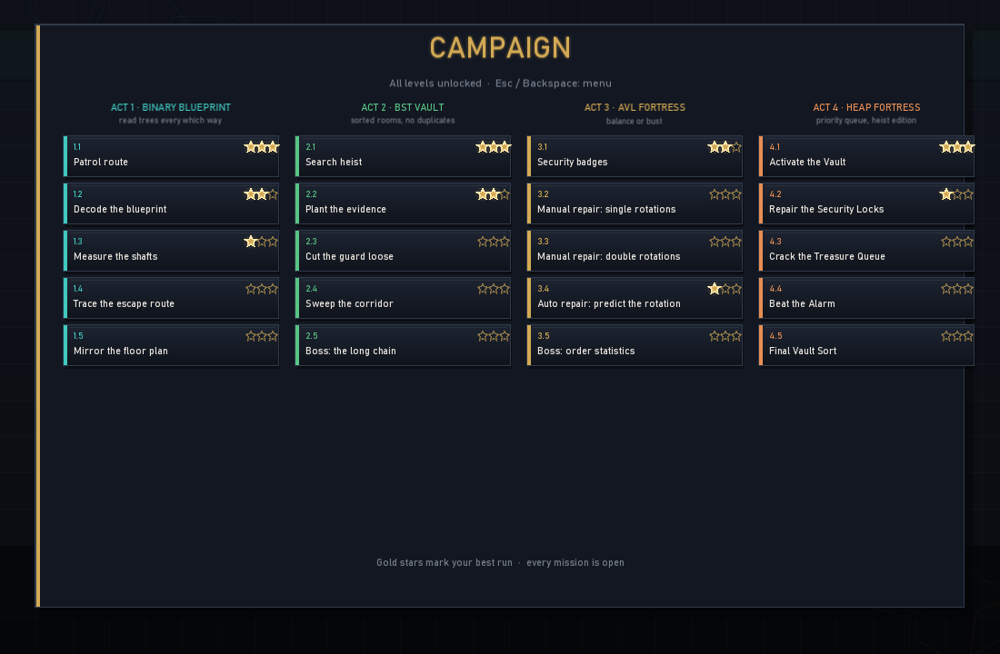

*Figure 2. Campaign map — four acts, star progress, locked levels.*

### 5.3 Act 1 — binary tree level

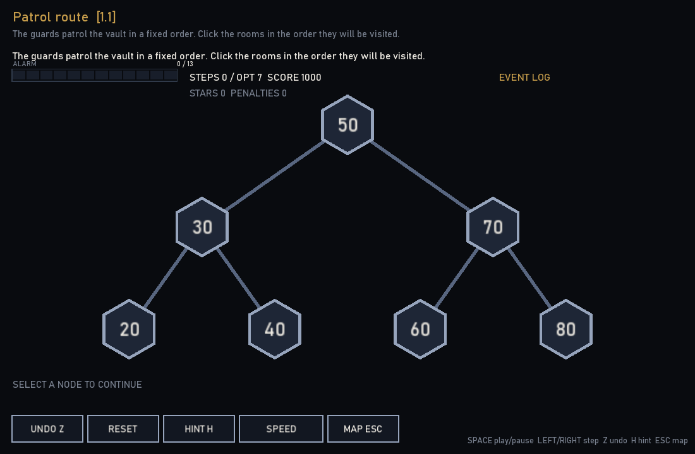

*Figure 3. Act 1 level UI: tree canvas, alarm HUD, toolbar (undo / hint / replay / reset).*

### 5.4 Act 2 — BST level

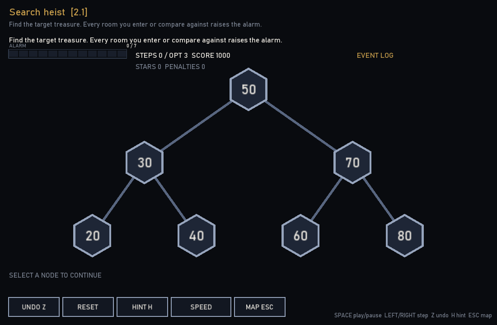

*Figure 4. Act 2 BST mission in the same chrome; path clicks and status from LevelPlay.*

### 5.5 Act 3 — AVL level

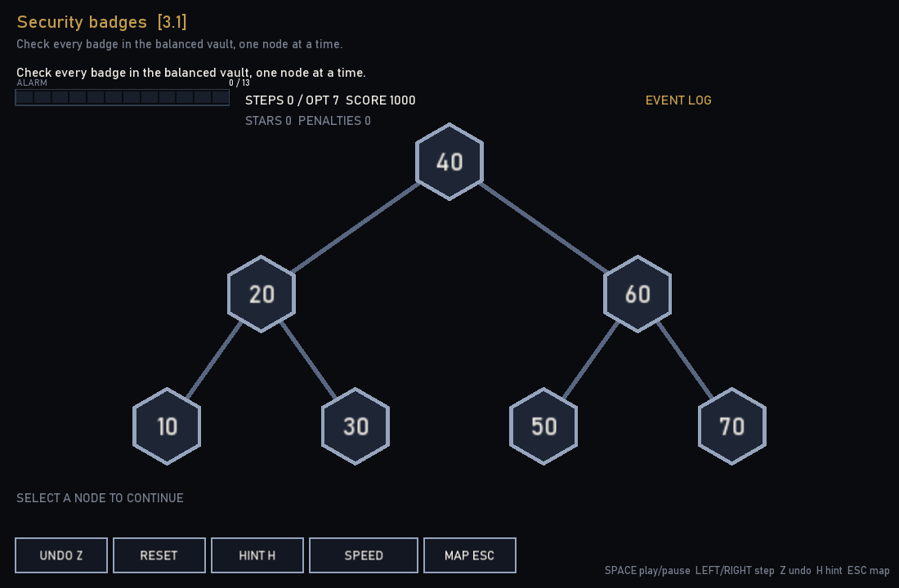

*Figure 5. Act 3 AVL repair / badges UI with selection and rotation controls.*

---

## 6. The four AVL rotations

Each pair shows the **unbalanced** tree that needs the case (left chain, right chain, or zigzag), then the **rebalanced** tree after the rotation(s). Captures use the same insert order as the live AVL path; the before frame is the BST shape (no rebalance) so the imbalance is visible.

### 6.1 LL — right rotation

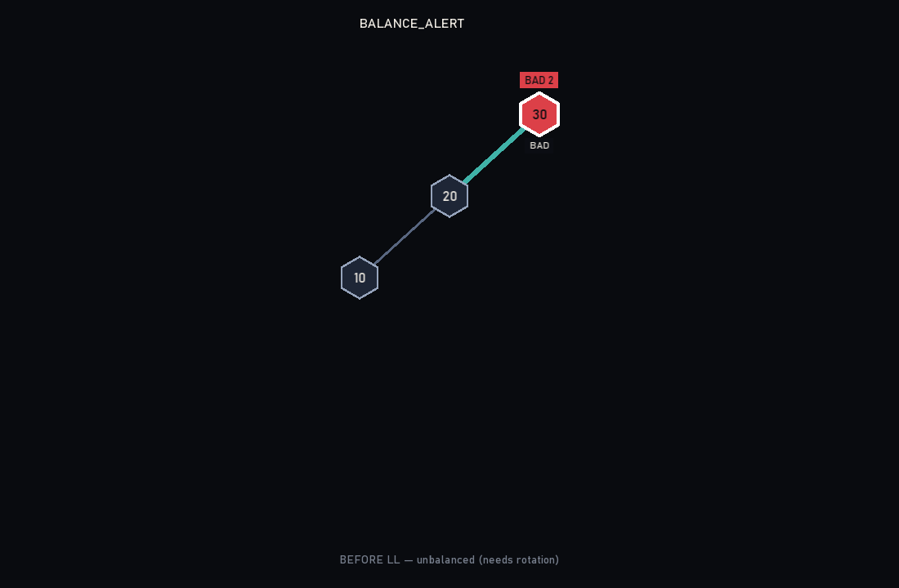

*Figure 6a. LL before: left chain `30 → 20 → 10` (balance factor +2 at the root).*

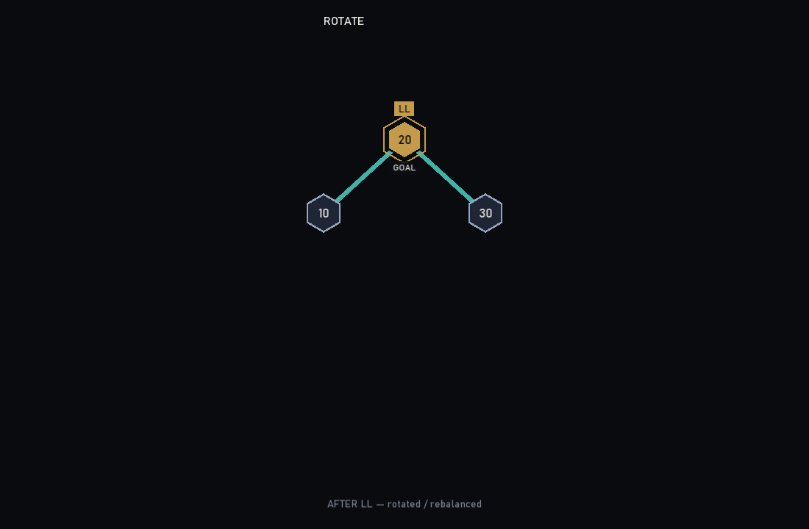

*Figure 6b. LL after: one right rotation at `z` → root `20` with children `10` and `30`.*

### 6.2 RR — left rotation

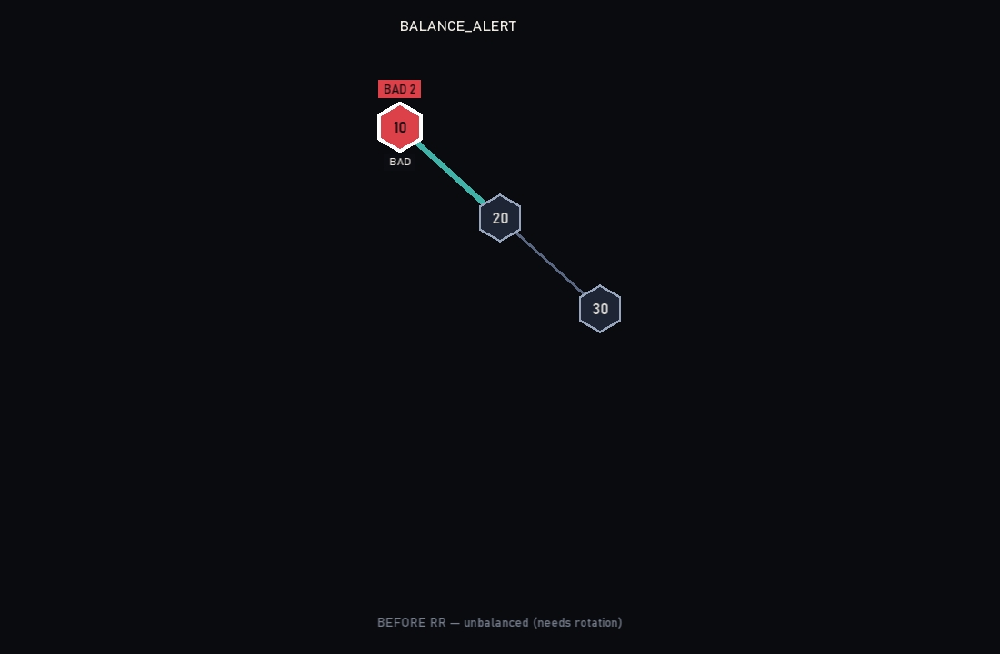

*Figure 7a. RR before: right chain `10 → 20 → 30`.*

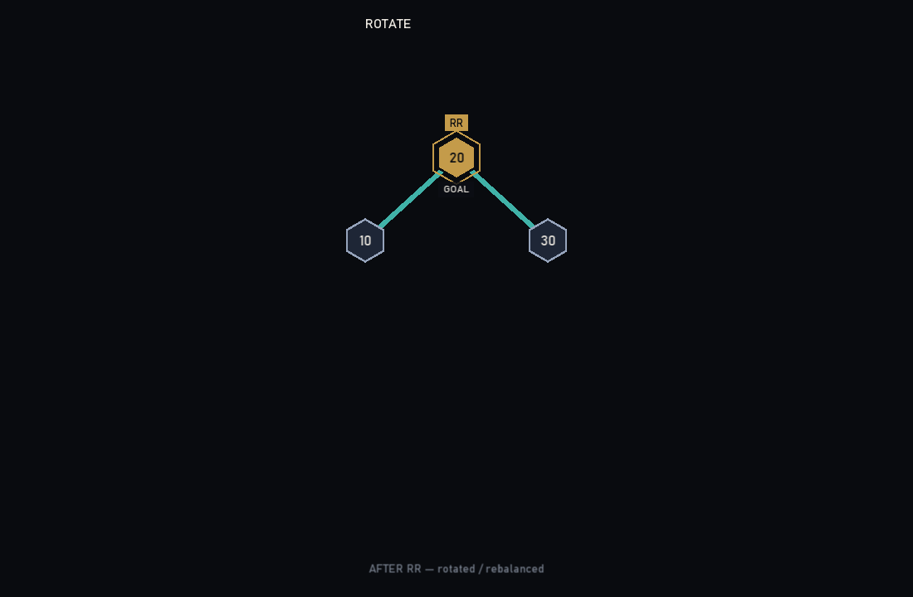

*Figure 7b. RR after: one left rotation at `z` → balanced `20 / 10 / 30`.*

### 6.3 LR — double rotation

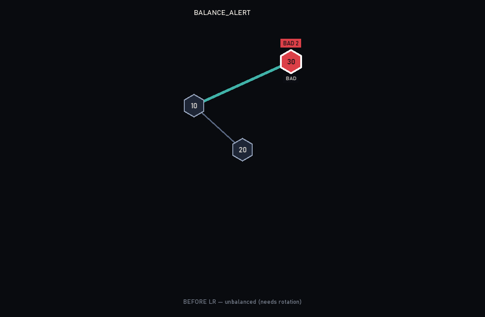

*Figure 8a. LR before: zigzag `30 ← 10 → 20` (left-heavy `z`, right-heavy left child).*


*Figure 8b. LR after: left at `z→left`, then right at `z` → root `20`.*

### 6.4 RL — double rotation


*Figure 9a. RL before: zigzag `10 → 30 ← 20`.*


*Figure 9b. RL after: right at `z→right`, then left at `z` → root `20`.*

Each primitive emits a `ROTATE` event (pivot, rising node, parent, case). Doubles emit two primitives with the same case label. The zero-balance heavy-child rule uses `>= 0` / `<= 0` so deletion cases take a single rotation when appropriate.

---

## 7. Act 4 — Max Heap and Heap Sort

The brief asks for demonstrations of heap construction, extraction, heapify, and the final sorted result. The figures below are from the synchronised heap **tree + array** view (`HeapView`) used by Act 4 / Sandbox.

In gameplay the player:

1. Builds a Max Heap (or starts from a generated / disturbed array).  
2. Extracts the maximum by selecting **root and last active** leaf, confirming the seal into the sorted region.  
3. Restores the heap property with **manual parent–child swaps**.  
4. Repeats until the array is sorted (Heap Sort finale) or the race quota is met.

### 7.1 Heap construction

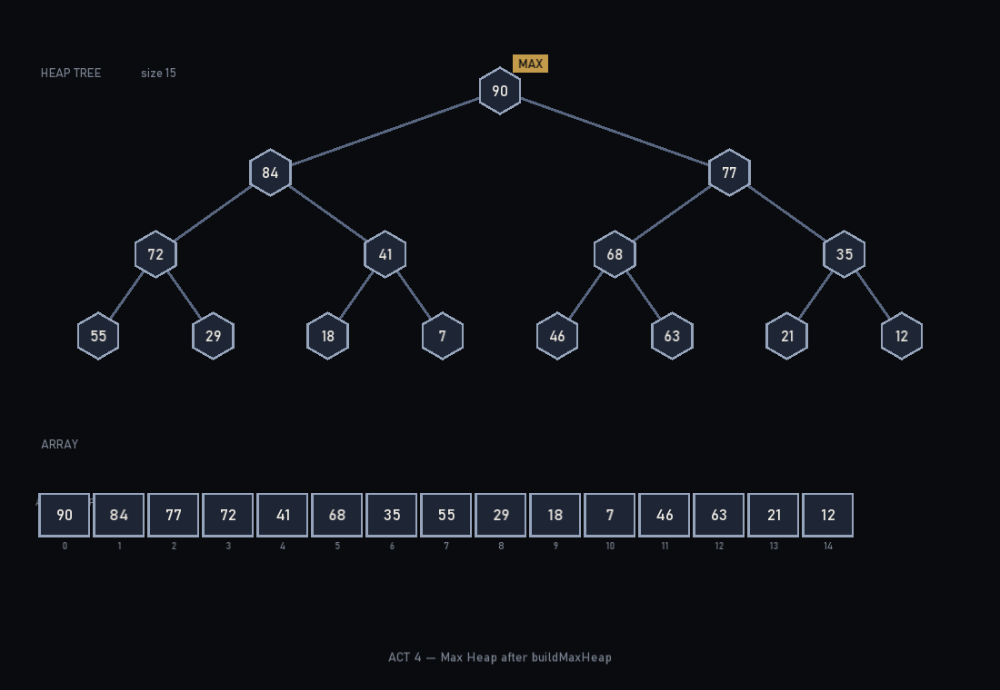

*Figure 10. After `buildMaxHeap`: every parent ≥ its children; root holds the maximum.*

### 7.2 Extraction

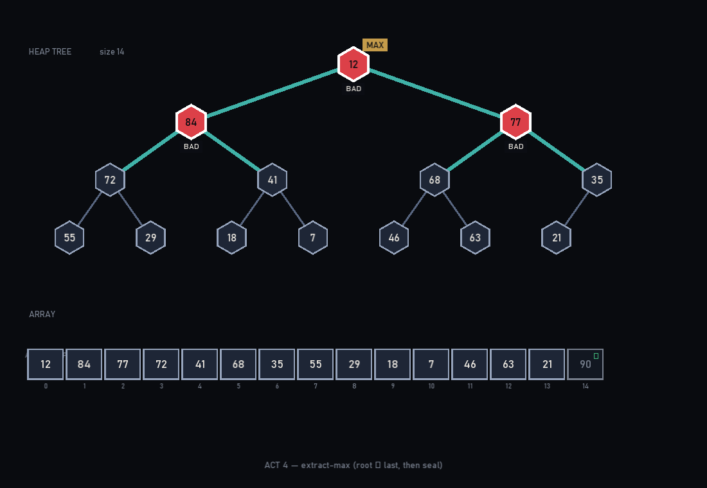

*Figure 11. Extract-max: root swapped with the last active element; `90` sealed into the sorted region (size 14).*

### 7.3 Heapify

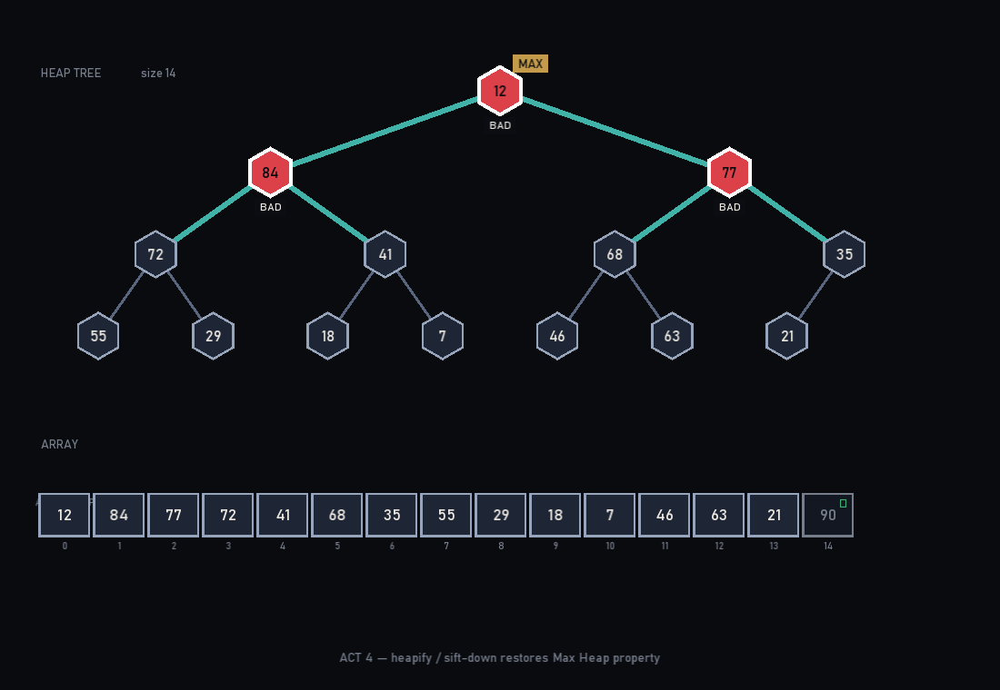

*Figure 12. Heapify / sift-down restores the Max Heap property after extract (highlighted path).*

### 7.4 Final sorted result

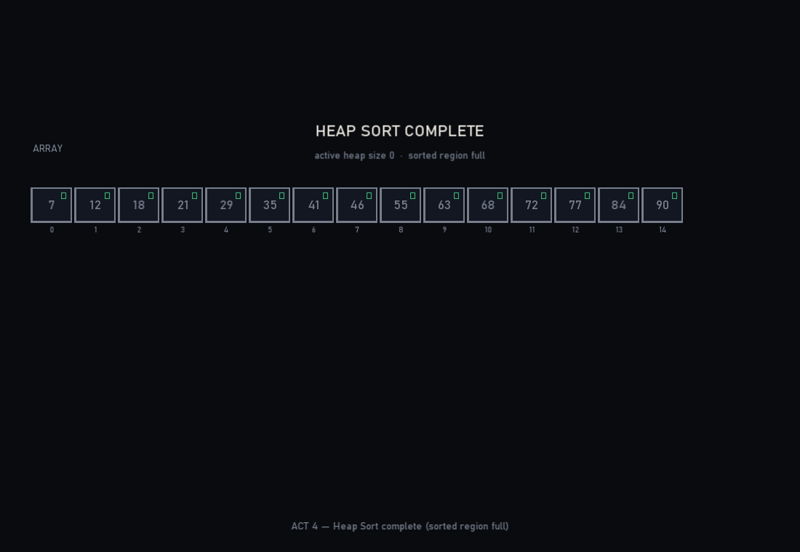

*Figure 13. Heap Sort complete — sorted array (ascending); active heap empty.*

---

## 8. Benchmarking (Section 10)

Reproduce from the repository root:

```powershell
cmake --build build --target bench
.\build\bin\bench.exe
```

Results are written to `bench/results/`. Event recording is off. Seeds are fixed so comparison/swap counts match across machines; wall-clock microseconds may vary slightly. No `std::sort` is used.

### 8.1 Height after insertion

| n | BST sorted | AVL sorted | BST random | AVL random |
| ---: | ---: | ---: | ---: | ---: |
| 100 | 100 | 7 | 14 | 8 |
| 1,000 | 1,000 | 10 | 21 | 12 |
| 10,000 | 10,000 | 14 | 32 | 16 |

Sorted BST becomes a right chain (height ≈ n). AVL on the same keys stays near log₂ n (e.g. height 14 at n = 10,000 after 9,986 rotations while inserting). Random BST is better than sorted but still taller than AVL.

### 8.2 Search (10,000 queries on random trees)

| n | BST avg comparisons | AVL avg comparisons |
| ---: | ---: | ---: |
| 100 | 6.53 | 5.82 |
| 1,000 | 13.46 | 9.26 |
| 10,000 | 17.04 | 12.61 |

Taller trees cost more comparisons; AVL tracks log n more closely.

### 8.3 AVL rotations

Sorted inserts average ~0.99 rotations per key; random inserts ~0.67. Deletes can cascade; the worst single delete in these runs used up to **6** primitive rotations (random, n = 10,000).

### 8.4 Order statistics (1,000 queries)

| n | AVL `kth` (µs) | BST inorder scan (µs) |
| ---: | ---: | ---: |
| 100 | 125 | 3,897 |
| 1,000 | 196 | 36,301 |
| 10,000 | 208 | 539,485 |

AVL `kth` walks one path using subtree sizes. The BST baseline rebuilds/walks an inorder list per query (≈ O(n)), so cost explodes with n.

### 8.5 Heap build and sort

Bottom-up `buildMaxHeap` comparisons grow roughly linearly (random n = 10,000 → 19,329 comparisons). Heap Sort remains O(n log n) across random / sorted / reverse / duplicate inputs. At n = 2,000 versus hand-written baselines: Heap Sort ~993 µs, insertion sort ~10.4 ms, selection sort ~15.9 ms. Heap Sort extra space is 0 (in-place).

**Takeaway.** The numbers match the theory the campaign teaches: unbalanced BSTs hurt search; AVL pays rotations to keep height small; size-augmented order statistics beat full scans; heaps beat quadratic sorts at larger n.

---

## 9. Testing

`tests.exe` reports one PASS/FAIL line per check. A full run used for this report was **663 PASS, 0 FAIL** (`tests/TEST_REPORT.md`).

| Area | Focus |
| --- | --- |
| BinaryTree / BST / AVL | Shapes, events, errors, recording on/off |
| Validators | Ordering, height/size, parents, heap property |
| Layout / motion | Replay and undo frames match `TreeLayout` |
| Acts 1–4 + snapshots | Load, optimal/capacity, scripted 3-star clears, penalties |
| Endless | Run ends; survival score recorded |

---

## 10. Build and run

```powershell
cmake -S . -B build
cmake --build build -j 4
.\build\bin\vaultheist.exe
.\build\bin\tests.exe
.\build\bin\bench.exe
```

Run executables from the repository root so `data/` and fonts resolve. Full controls are in `README.md` (campaign clicks, Esc, Act 4 swap/extract, animation Space / arrows, Endless type+Enter).

Level data lives in `data/levels/*.json`. Adding a level is documented in `docs/level-guide.md` and `docs/level-format.md`.

---

## 11. Conclusion

We delivered a playable Vault Heist campaign on from-scratch trees and heaps, with an event-driven GUI, undo/replay, Endless mode, persistence and a reproducible Section 10 benchmark suite. The architecture keeps the model free of SFML so the same structures are covered by hundreds of unit checks. Benchmarks confirm the classroom story: balance and subtree sizes matter in practice, and Heap Sort scales better than simple quadratic sorts. Remaining viva topics are the same ones practised in-level: traversal order, BST paths, AVL cases, `kth(n−k+1)`, and manual heap restore after extract.

Both members contributed to design and implementation and can explain the full system in viva. Arslan: animation controller, Act 4 heap UI/logic integration, vault chrome hosting, Endless/leaderboard polish, benches/report. Anas: Acts 1–3 LevelPlay logic, tree animation view, campaign/menu visual pass on `develop`.
