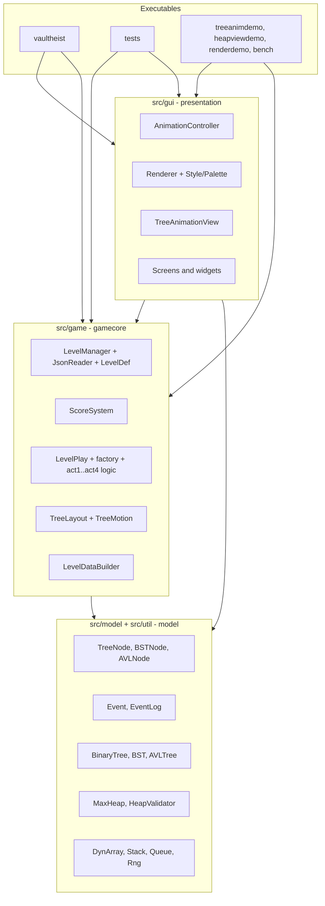

# Part A report draft (P3.4a)

*Draft for Anas to turn into the PDF. Every statement below was checked against
the current source. All numbers come from `tests/TEST_REPORT.md`; no benchmark
numbers are included yet.*

## 1. System architecture

The code is split into four layers. Dependencies point downward only: the model
knows nothing about the game or the GUI; gamecore knows the model; the GUI knows
gamecore and the model; executables assemble the layers.

- **Model** owns the data and emits `EventLog`s. `BinaryTree` is the general
  tree; `BST` adds ordered keys and search/insert/delete; `AVLTree` derives from
  `BST` and maintains height, size and balance through hooks.
- **Gamecore** owns level definitions, deterministic data generation, scoring,
  level-play logic and pure geometry. `LevelManager` parses `data/levels/*.json`;
  `ScoreSystem` computes steps, alarm, capacity and stars; `LevelPlay` is the
  common front door for the screens.
- **GUI** renders state and plays events. `AnimationController` is Arslan's
  replay driver, `Renderer` is the only drawing API, and `TreeAnimationView` is
  the A6 listener. Colour and state tags come from the shared `Palette` and
  `NodeState`.
- **Executables** are thin: `src/main.cpp` builds the screen manager; the demos
  construct a model, operation and animation script directly.

## 2. Event model, replay and undo

Every model operation returns a result containing an `EventLog` (for example
`BST::OpResult`, `BinaryTree::TraversalResult`, `BuildResult`). Events are plain
value records: type, two node ids, side, key, old/new values and an extra field.
They describe *what happened*, not how to draw it.

The model mutates once, while the event log is replayed many times:

1. `AnimationController::load` stores the log and calls `rebuild()`.
2. `rebuild()` calls `listener->reset()`, replays all completed events at
   `progress = 1`, then replays the active event with eased progress.
3. `finishInstantly()`, `stepForward()`, `stepBackward()` and `pause()` all end in
   the same `rebuild()`. Undo is therefore "replay a shorter prefix", not an
   inverse operation on the tree.
4. `TreeAnimationView` stores only the active event and a replay counter.
   `TreeMotion::frameAt(index, progress)` rebuilds an absolute `TreeLayout` for
   that replay position; no node keeps an incremental position.

This is what makes undo and skip-to-end exact: the final frame is the same
computed layout, regardless of how the controller reached it. It also makes the
model easy to test — tests compare event types, order and payloads, and can run
with `recordEvents = false` to verify that results and shapes are identical with
empty logs. Deterministic `Rng` seeds and the absence of global state make a
replay reproducible on any machine.

## 3. Conventions

- **Height** counts nodes on the longest downward path: empty tree `0`, leaf
  `1`. `AVLNode` starts with `height = 1`.
- **Size** is the number of nodes in a subtree; `AVLNode` starts with `size = 1`.
- **Balance factor** is `height(left) - height(right)`; `nullptr` has factor 0.
  A node is balanced when `|factor| <= 1`.
- **`key == value`** for every `BSTNode` and `AVLNode`, including after the
  two-child delete's value swap.
- `updateStats` and `TreeValidator` recompute height before size;
  `isBalanced` and `recomputeStats` recompute both from the real shape and never
  trust stored fields.

## 4. Complexity analysis

Notation: `n` nodes, `h` tree height (`h = O(log n)` for AVL, `O(n)` for a plain
BST/binary tree), `k` the requested rank, `m` the number of keys reported by a
range query.

### 4.1 BinaryTree (derived from `src/model/tree/BinaryTree.cpp`)

| Operation | Time | Justification from the code |
| --- | --- | --- |
| constructor, `empty()`, `root()`, `setRecordEvents`, `isRecording` | O(1) | Only a few fields are read or written. |
| destructor, `clear()` | O(n) | `destroyNodes` visits every node once. |
| `size()` | O(n) | Iterative stack counts all nodes; no stored count. |
| `height()`, `height(node)` | O(n) | Iterative stack visits nodes and tracks the deepest depth. |
| `preorder`, `inorder`, `postorder` | O(n) | Recursive helper emits one `VISIT` per node. |
| `preorderIterative`, `inorderIterative`, `postorderIterative`, `levelOrder`, `levelOrderIterative` | O(n) | Explicit `Stack`/`Queue`, one pop per node. |
| `buildFromPreorderInorder`, `buildFromPostorderInorder` | O(n) | Input validation plus `buildPreIn`/`buildPostIn` create each node once. |
| `diameter()` | O(n) | `diameterRec` visits each node once and updates the best path. |
| `lca(a, b)` | O(n) | Two `findById` walks plus two `depthOf` parent walks; `findById` dominates. |
| `pathTo(id)` | O(n) | `findById` then one parent-pointer walk to the root. |
| `findById`, `findByValue` | O(n) | Iterative stack search; no ordering assumption. |
| `swapChildren(id)` | O(n) | One `findById` followed by a constant-time pointer swap. |
| `mirror()` | O(n) | `mirrorRec` swaps children at every node. |
| `isSameTree`, `isSymmetric` | O(n) | Recursive pairwise comparison visits each node once. |
| `serialize()`, `deserialize()` | O(n) | One token per node and one `TreeNode` per token. |

### 4.2 BST (derived from `src/model/tree/BST.cpp`)

| Operation | Time | Justification from the code |
| --- | --- | --- |
| `insert(key)` | O(h) | One root-to-leaf comparison path, then one node creation. |
| `search(key)` | O(h) | One comparison per visited node. |
| `deleteKey(key)` | O(h) | Locate the node, find the successor in its right subtree, detach in O(1). |
| `findMin`, `findMax` | O(h) | Follows left/right links from the root to the extreme. |
| `successor`, `predecessor` | O(h) | Single root-to-leaf walk with a candidate pointer. |
| `rangeQuery(lo, hi)` | O(h + m) | Inorder walk with pruning: visited nodes plus reported keys; pruned subtrees emit one `HIGHLIGHT_SUBTREE` each. |
| `kthSmallest(k)` | O(h + k) | Iterative inorder walk stops after the k-th pop. |
| `lcaBST(a, b)` | O(h) | One comparison walk toward the split point. |
| `buildChain(n)` | O(n) | Creates and links each node directly; no search per insert. |
| `findNode`, `subtreeMin`, `subtreeMax` | O(h) | Plain pointer walks. |
| `afterInsert`, `afterRemoval` (base) | O(1) | Protected no-op hooks. |

### 4.3 AVLTree (derived from `src/model/tree/AVLTree.cpp`)

| Operation | Time | Justification from the code |
| --- | --- | --- |
| `insert`, `deleteKey` (inherited BST + hooks) | O(log n) | BST search is `O(h)`; `rebalanceFrom` walks parent links up at most `h` levels, and `h` is logarithmic after every rebalance. |
| `afterInsert`, `afterRemoval` | O(log n) | `updateStats` is O(1) per ancestor; the walk and at most two rotations per unbalanced node are O(log n). |
| `rebalanceFrom(start)` | O(log n) | Moves from `start` to the root; each case performs one or two O(1) primitives. |
| `rotateLeftAt`, `rotateRightAt` | O(1) | A constant number of pointer changes plus two `updateStats` calls. |
| public `rotateLeft(id)`, `rotateRight(id)` | O(n) + O(1) | `BinaryTree::findById` searches the whole tree before the constant-time rotation. |
| `balanceFactor(node)` | O(1) | Reads two stored heights. |
| `kth(k)` | O(log n) | Descends one path using stored subtree sizes. |
| `rank(key)`, `countLess(key)` | O(log n) | Single comparison walk accumulating subtree sizes. |
| `countInRange(lo, hi)` | O(log n) | `rank(hi) - countLess(lo)`; no traversal. |
| `isBalanced()` | O(n) | Iterative postorder recomputes height and size for every node. |
| `recomputeStats()` | O(n) | Same postorder, writing the stored fields; emits no events. |
| `deserialize`, both build functions | O(n) | Base build/parse is O(n); `recomputeStats` adds one more O(n) pass. |
| `rotationCount`, `lastRotations` | O(1) | Field reads. |

## 5. Test strategy and real counts

`tests.exe` prints one `PASS`/`FAIL` line per check. The current run is
**589 PASS, 0 FAIL**. `tests/TEST_REPORT.md` lists the tree suites by case name:

| Suite | Checks | Passed |
| --- | ---: | ---: |
| BinaryTree | 81 | 81 |
| BST | 136 | 136 |
| AVL | 154 | 154 |
| Tree validator | 24 | 24 |
| Tree layout | 20 | 20 |
| **Tree suites total** | **415** | **415** |
| **Whole executable** | **589** | **589** |

The strategy has four parts:

1. **Per-operation checks** — exact shapes, event order and payloads, error
   messages, and recording on/off parity for every model operation.
2. **Independent structural checker** — verifies ordering, `key == value`,
   parent links, id uniqueness and recomputed height/size/balance after every
   operation in seeded differential runs (1000 insertions, 500 mixed BST/AVL
   operations, 10,000 sorted insertions and deletions).
3. **Cross-cutting suites** — the read-only validator on deliberately corrupted
   trees; the layout engine on empty, single, skewed, full, 200-node random and
   10,000-node trees; and `TreeMotion` assertions that every replay, skip and
   undo frame equals `TreeLayout`.
4. **Game logic** — every one of the 15 act levels loads through `LevelManager`,
   has a model-computed optimal step count and matching capacity, wins with
   three stars under scripted perfect play, and charges the specified penalties
   for wrong moves and hints.

## 6. The four rotations

All four screenshots were produced by `treeanimdemo --shots`, which plays real
AVL inserts, steps the animation to the last `ROTATE` event and captures that
frame. Each case also has a `_before` image taken immediately before the first
rotation event.

| Case | Trigger | Primitive sequence | Screenshot |
| --- | --- | --- | --- |
| **LL** | unbalanced node `z` is left-heavy and its left child is left-heavy or balanced (`balanceFactor(z->left) >= 0`). | One right rotation at `z`. | `screenshots/rotation_LL.png` (before: `rotation_LL_before.png`) |
| **RR** | `z` is right-heavy and its right child is right-heavy or balanced (`<= 0`). | One left rotation at `z`. | `screenshots/rotation_RR.png` (before: `rotation_RR_before.png`) |
| **LR** | `z` is left-heavy but its left child is right-heavy. | Left rotation at `z->left`, then right rotation at `z`. | `screenshots/rotation_LR.png` (before: `rotation_LR_before.png`) |
| **RL** | `z` is right-heavy but its right child is left-heavy. | Right rotation at `z->right`, then left rotation at `z`. | `screenshots/rotation_RL.png` (before: `rotation_RL_before.png`) |

The `>= 0` / `<= 0` comparisons are the deletion rule: a heavy child with
balance factor zero takes a single rotation. Each primitive emits a `ROTATE`
event with the pivot in `idA`, the rising node in `idB`, the pre-rotation parent
id in `key` and the case in `extra`; a double rotation emits two events with the
same case name.

## 7. Benchmark analysis

*Placeholder — this section is filled in after the benchmark CSVs exist. No
timings or throughput numbers are reported in this draft.*
